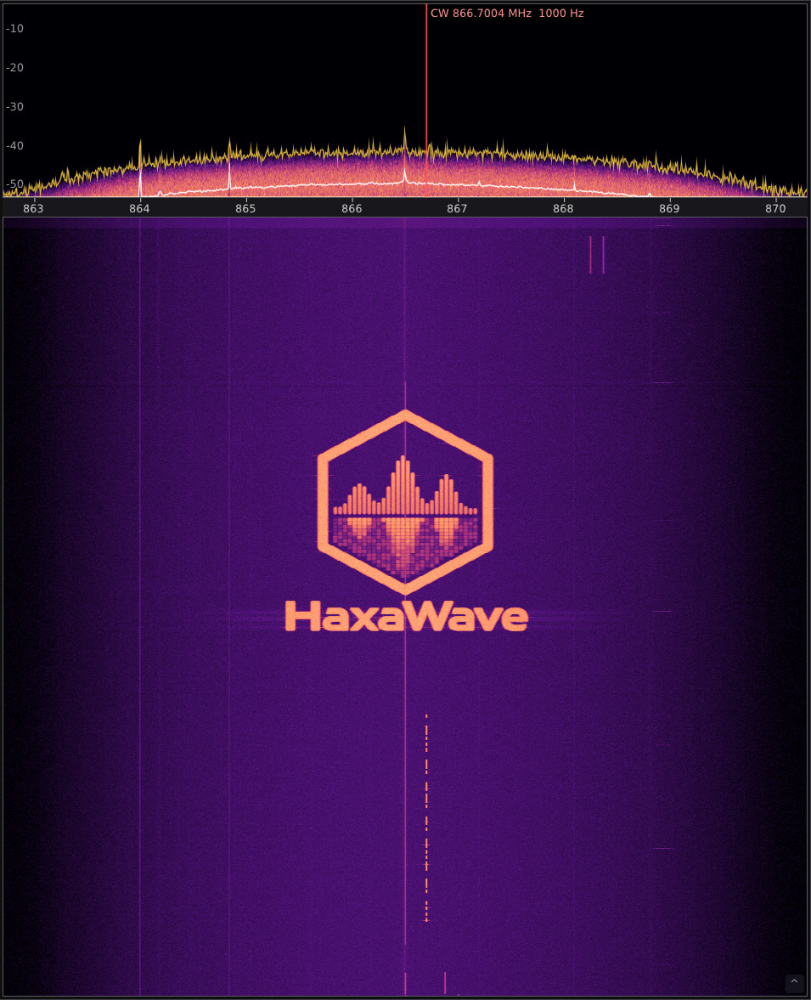
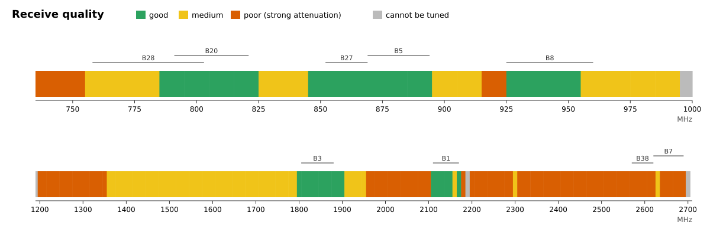
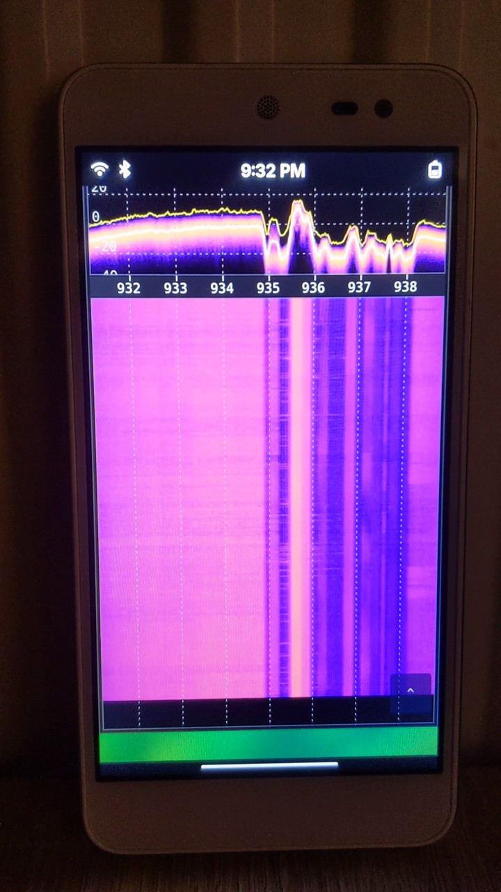
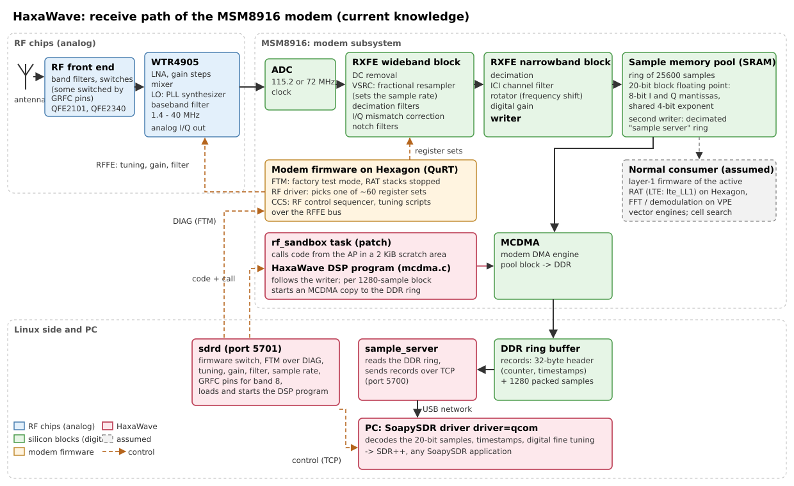

<p align="center">
  
</p>

# HaxaWave

**The modem of a phone is a software-defined radio. HaxaWave lets you use it.**

HaxaWave runs your own code on the Hexagon DSP of a Qualcomm MSM8916 phone
modem. Currently the main application is turning its receiver into an **SDR
receiver**: 735 - 995 MHz and 1195 - 2700 MHz, up to **14.8 MS/s**, analog
filter up to 40 MHz, 20-bit (block floating point) samples with hardware
timestamps, streamed to your PC over USB. Like any SDR worth the name, it speaks
the SoapySDR API.

<p align="center">
  <a href="https://www.youtube.com/shorts/8ix2WnSbnKw"></a><br>
  <em>Logo from another SDR, received by the phone over a cable (<a href="https://www.youtube.com/shorts/8ix2WnSbnKw">video</a>).</em>
</p>

**Works on: Wileyfox Swift** (Snapdragon 410 / MSM8916, Longcheer L8150 board) -
a budget phone released in 2015, built on a generic board that it shares with
several Android One phones. It runs Nura (formerly postmarketOS; why Nura and
not Android: see the [chapter below](#why-nura-and-not-android)).

> **EXPERIMENTAL SOFTWARE. USE AT YOUR OWN RISK.** This is an early research
> project. It modifies the firmware and the kernel of your phone, it can crash
> the modem, and it can make the phone unusable until it is reflashed or
> rebooted. Sensitivity differs strongly between bands. It is developed and
> tested on **one phone** only (Wileyfox Swift). No warranty of any kind.

## Why

- Every phone contains a complete radio: a tunable RF front end, converters and
  a DSP built to process signals. It is locked to what the manufacturer
  intended.
- Our devices are being locked down in small steps, each too small to object to.
  Opening up a closed part like the modem is one small step the other way; if it
  could be automated, it would benefit everyone.
- Modems like this one are built into a great many devices, which is what makes
  them interesting as SDRs. For now there is a way to get that potential out of
  one phone. Maybe someday, out of more.
- Qualcomm modems have been studied for years, mostly by security researchers,
  and most of what is publicly known about them comes from that work. HaxaWave
  builds on it, but with a different goal: new uses of the radio for the owner
  of the phone.
- The approach chosen here is to run **custom code on the modem's Hexagon DSP**:
  a small patch to the modem firmware adds one task that calls code supplied by
  the application processor (the Linux side of the phone). Everything else is
  ordinary software.
- The Hexagon can do far more than hand out IQ samples. Much of the baseband
  processing of a Qualcomm modem runs as software on it, next to dedicated
  hardware. This generation has vector coprocessors (VPE) with their own
  instruction set; newer Hexagons have vector instructions (HVX) built into the
  core itself. That makes it a promising general platform for **implementing
  whole radio algorithms** and not only cellular modems. So far HaxaWave uses it
  only to copy the samples out; the SDR receiver is the first step.

## What works

- **Frequency**: 735 - 995 MHz and 1195 - 2700 MHz, any frequency (the receiver
  is tuned in 100 kHz steps inside the LTE bands and 1 MHz steps elsewhere; the
  driver shifts the remainder digitally)
- **Sample rate**: 7.2 - 11.25 and 14.4 - 14.8 MS/s, any value; CF32 and CS16;
  20 bits per complex sample on the wire
- **Analog filter**: 1.4, 3, 5, 10, 15, 20, 40 MHz; gain in six steps (about 18
  dB)
- **Time**: every read returns the time of its first sample on the receiver's
  own 19.2 MHz clock
- **API**: SoapySDR (`driver=qcom`); tested with SDR++ and a simple real-time
  spectrum analyzer (see Demos)



**Green**: good reception. **Yellow**: medium. **Orange**: strong attenuation in
the receive path of this board, only strong signals are visible. **Grey**:
cannot be tuned. Good: 790 - 830 MHz (band 20), 850 - 900 MHz (bands 27 and 5),
930 - 960 MHz (band 8, GSM900), 1800 - 1910 MHz (band 3, GSM1800) and 2110 -
2160 MHz (band 1). Weak: below 760 MHz, 1200 - 1360 MHz, 1960 - 2110 MHz and
most of 2200 - 2700 MHz.

## Demos

The demos use a small real-time spectrum analyzer (a phosphor-style histogram
above a waterfall). It is simple but fast, was written with the help of language
models, and talks to the radio only through SoapySDR, so it works with
`driver=qcom` and with other devices such as a USRP (`driver=uhd`). The first
demo, a logo drawn on the waterfall, is at the top of this page. Click a picture
to play the video on YouTube.

### USRP B210 and the Qualcomm MSM8916 side by side

[](https://www.youtube.com/watch?v=MTza5gCoVYE)

Two instances of the spectrum analyzer tuned to the same part of the LTE uplink:
a USRP B210 on the left and the phone's modem (Qualcomm MSM8916) on the right.
The two waterfalls are very similar: the same transmissions show up in both at
the same moments. The shape of the noise floor across the band is different.

[Video on YouTube](https://www.youtube.com/watch?v=MTza5gCoVYE) (20 s)

### The same program on the phone itself

<p align="center">
  <a href="https://www.youtube.com/shorts/3QOQ8pN5d0w"></a>
</p>

The same spectrum analyzer also runs on the Wileyfox Swift itself, with
`driver=qcom` pointing at the sample service on the same phone: the spectrum on
the screen comes from the phone's own modem.

[Video on YouTube](https://www.youtube.com/shorts/3QOQ8pN5d0w) (21 s)

## Supported hardware

- **Tested: Wileyfox Swift** (Snapdragon 410 / MSM8916, Longcheer L8150 board;
  Nura device name `wileyfox-crackling`). It costs up to 50 GBP, but it is hard
  to get outside the UK, and its twins are hard to find as well.
- **Twins, not tested:** Cherry Mobile One G1, i-mobile IQ II, General Mobile
  4G. These Snapdragon 410 phones are reported to be rebrands of the same
  Longcheer L8150 board. The modem images of the i-mobile IQ II and the Cherry
  Mobile One G1 come from the same firmware branch as the Wileyfox Swift and
  carry the same RF chips (WTR4905 transceiver); the General Mobile 4G image has
  not been checked.
- **Related, more porting needed:** BQ Aquaris X5 (MSM8916, Longcheer L8910
  board).
- **Why the Wileyfox Swift:** it does not block custom modem firmware. The modem
  image must have a signature block in the right format, but the signature
  itself is not verified; only the hashes of the image segments are checked, and
  the build computes them. This is what made this work possible on this phone.
- Porting to another phone needs at least its own device tree for the 88 MiB
  modem region and adapted scripts in `pmos/`. Whether a phone accepts a custom
  modem image has only been verified on the Wileyfox Swift.

## How it works

1. **A task that runs your code.** The patch adds the task `rf_sandbox` to the
   modem firmware. Its only job is to call code that the application processor
   writes into a small executable scratch area of the modem, and to report the
   result back.
2. **The loaded code copies the samples.** The SDR program (`sdr/dsp/mcdma.c`)
   runs on the Hexagon in a loop. It watches the write position of the
   receiver's sample writer and, for every completed block of 1280 samples, asks
   the modem's own DMA engine (MCDMA) to copy it from the sample memory pool to
   a ring buffer in DDR, over and over (a record is a 32-byte header with a
   counter and timestamps plus the packed samples).
3. **Where the samples come from.** The signal goes from the RF transceiver to
   the ADC and the receiver front end of the modem. One of its narrowband
   writers continuously stores the samples in a ring in the sample memory pool
   (internal SRAM) as 20-bit block floating point (8-bit I and Q mantissas and a
   shared 4-bit exponent). The writer runs when the modem is in the LTE factory
   test mode, which the service `sdrd` enters through the modem's diagnostic
   port; `sdrd` also tunes the receiver, using the tuning sequences of the
   firmware itself.
4. **To the PC.** On the phone, `sample_server` reads the ring and sends the
   records over TCP; the SoapySDR driver on the PC decodes them. `sdrd`
   (TCP 5701) controls tuning, gain, bandwidth and sample rate; no SSH is needed
   once it is installed.

**How the sample memory was found.** Early versions of the task could hash and
dump memory. With them, memory areas that are contiguous and change often as a
whole were searched for, and then their contents were checked for resemblance to
samples, including IQ samples in various formats. That is how the sample pool
and its 20-bit format were identified. These helper commands are not part of the
task any more.

### The key things that made this work possible

- The Wileyfox Swift checks only the hashes of the modem image segments, not the
  signature itself, so a custom modem firmware can be loaded. That is a happy
  accident: Qualcomm limits what users can know and do with their chips, and
  this phone happens to leave the door open.
- It's possible to find (partial) sources of the modem firmware that can be
  built and even be forced to run on this phone - even though the phone was
  released later.
- The Factory Test Mode (FTM) exists and gives manual control of the receiver.
- A good way to run your own code on the phone is to add a tiny new task that
  runs code supplied by the AP. In HaxaWave the task is called `rf_sandbox`. It
  is created when QuRT (the Hexagon's operating system) boots. It is not known
  whether tasks can be created after QuRT has booted.
- Finding the samples (described above): the 20-bit float format with 8-bit I
  and Q and a shared 4-bit exponent was unusual and had to be worked out from
  the data.

## The receive path: what is known

What the project has found out about the chain from the antenna to the samples.
Items marked _(assumed)_ are inferred from the firmware and from measurements,
not confirmed.



**Chips (silicon, analog).**

- RF front end: band filters and switches. Some are switched by GRFC pins of the
  modem chip (band 8 needs them); front-end modules (QFE2101, QFE2340) sit on
  the RFFE control bus.
- **WTR4905** RF transceiver: low-noise amplifier, mixer with a PLL-synthesised
  local oscillator, analog baseband filter (1.4 - 40 MHz) and gain steps. The
  modem programs it over the RFFE bus through its RF control sequencer (CCS),
  with tuning scripts taken from the firmware.

**Blocks in the modem chip (silicon, digital, configured by software).** The
analog I/Q signal enters the modem part of the MSM8916 and goes through the
receiver front end (RXFE):

1. **ADC** (clocked at 115.2 or 72 MHz in the modes used here).
2. **Wideband block:** DC removal, a fractional resampler (VSRC) that sets the
   exact sample rate, decimation filters, I/Q mismatch correction, notch
   filters.
3. **Narrowband block:** more decimation, a channel filter (ICI), a digital
   rotator (frequency shift), digital gain, and a **writer** that stores the
   samples.
4. **Sample memory pool:** the writer fills a ring of 25600 samples in on-chip
   SRAM, as 20-bit block floating point (8-bit I and Q mantissas, shared 4-bit
   exponent). This ring is where HaxaWave picks the samples up.

The firmware does not program these blocks one by one: its RF driver picks one
of about 60 predefined register sets (per radio technology, bandwidth and RF
chip) and copies it into the hardware. HaxaWave starts from such a set and then
changes a few registers (rate, filter, gain).

**Software in between.** The modem's own RF software (RF driver, CCS scripts)
tunes the WTR4905 and configures the receiver front end when the factory test
mode is asked to receive on a channel. The DSP program of HaxaWave then copies
every finished block of the ring with the modem's DMA engine (MCDMA) to a ring
buffer in DDR, from where `sample_server` sends it to the PC. (The scratch area
of the `rf_sandbox` task holds only this program, not the samples.)

**Who normally uses the samples** _(assumed)_. In normal operation the layer-1
firmware of the active radio technology (for LTE: the closed `lte_LL1` part of
the firmware on the Hexagon) consumes the ring: it moves blocks with MCDMA and
runs the heavy processing (FFTs, demodulation) on the vector engines (VPE). A
second narrowband writer feeds a decimated "sample server" ring that is used for
cell search and measurements. The factory test mode has its own IQ capture
command that copies a short snapshot of the same memory to DDR.

## Factory test mode

The SDR runs while the modem is in its **factory test mode (FTM)**, the mode
manufacturers use to calibrate and test the radio. In FTM the radio access
technologies (the LTE, WCDMA and GSM protocol stacks) are stopped: the modem
does not search for a network, does not register and does not transmit on its
own. It only does what it is told over its diagnostic port: enter the test mode,
receive on a given channel. That makes it the easiest way to take manual control
of the receiver, and it is why the phone has no network while a stream runs.
`sdrd` handles FTM for you; it also stops and masks ModemManager for that time
(NetworkManager would otherwise start it again, and its start-up commands crash
the modem). Stopping the stream does not bring the network back: reboot the
phone, or run
`sudo systemctl unmask --runtime ModemManager && sudo systemctl start ModemManager`.

## Install

- **[`pmos/`](pmos/README.md)**: Nura image with a slightly patched kernel and
  the modem diagnostic port
- **[`firmware/`](firmware/README.md)**: builds the modem firmware (with the
  `rf_sandbox` task) and installs it on the phone
- **[`sdr/`](sdr/README.md)**: `sdrd` and `sample_server` on the phone, the DSP
  programs, and the SoapySDR driver for the PC

You need a Wileyfox Swift with an unlockable bootloader (installing Nura
**erases the phone's data**; the stock modem firmware stays on its partition and
can be selected again at any time) and a Linux PC with Docker, `fastboot`,
`python3`, `cmake`, a C++ compiler, `libsoapysdr-dev`, `curl` and a USB cable.
The guide uses the default login of the Nura image (user `user`, password
`147147`).

```
# 1. Nura with the slightly patched kernel (flashes the phone; follow pmos/README.md)
# 2. modem firmware
bash firmware/build.sh WORK
bash firmware/install_firmware.sh WORK/out/pil
# 3. sample service and SoapySDR driver
bash sdr/build.sh WORK
bash sdr/install.sh WORK
# 4. run any SoapySDR application, device "driver=qcom" (see sdr/README.md, "Run")
```

After a reboot the phone runs the stock modem firmware. `sdrd` loads the custom
firmware by itself when a client starts a stream (the first start takes about 20
s). `bash sdr/start.sh --switch` does the same in advance and checks the chain.

## Limitations

- If the modem crashes
  (`lte_rrc_controller.c:1373 Assert E_SUCCESS == result failed` in `dmesg`),
  `sdrd` restores the stream at the next start, but configuring it then takes
  30 - 50 s; a reboot of the phone makes it fast again.
- Switching between the stock and the custom firmware usually works, but after
  about ten restarts in a row the modem may fail to boot (`PBL boot timed out`
  in `dmesg`); a reboot of the phone fixes it.
- Sample rates between 11.25 and 14.4 MS/s cannot be set. Above 14.8 MS/s the
  USB network is too slow.
- Nothing can be received at 995 - 1195 MHz and above 2700 MHz.

## Where this is going

This is a beginning. The next steps are to use the Hexagon much more
(channelizers, demodulators and decoders running next to the receiver instead of
on the PC) and to move the approach to newer chips and to popular phones.

**Higher sample rates.** Two limits apply. To the PC it is the USB: the phone
has USB 2.0, a sample takes 2.5 bytes on the wire, and the link carries at most
about 37 MB/s, which is 14.8 MS/s. Inside the phone a continuous signal has so
far been obtained up to about 18 MS/s; above that the data in the source buffer
is no longer continuous, and this is where progress stopped. More should be
possible: the widest LTE channel (20 MHz) is sampled at 30.72 MS/s, but it has
not been reached. Getting such a stream to a PC would then need a faster link,
or processing on the Hexagon so that less data has to be sent.

**Newer phones.** Newer phones should allow more: faster USB, wider channels and
faster chips. It will also be harder, because the firmware is signed and
verified, and less information about the newer chips is available. The Wileyfox
Swift does not verify the signature of the modem image (only its hashes), which
made this work much simpler. More popular and newer phones do verify it, so
using a similar solution on them will first require getting around the
restrictions their manufacturers have put in place. How deep such restrictions
can be broken on Qualcomm chips is shown by A. Kozlov and S. Anufrienko,
[_Qualcomm BootROM: A Journey Through Sahara_](https://i.blackhat.com/Asia-26/Presentations/BHAS26-Kozlov-Anufrienko-Qualcom-REV01.pdf)
(Black Hat Asia 2026, CVE-2026-25262): a BootROM flaw in the emergency download
mode that bypasses signature verification on both the ARM and the Hexagon side
(with physical access); MSM8916 is among the affected chips.

Recreating the whole modem firmware with a free real-time OS is probably
possible and would give very good control over a single phone (or a few). It
would be a lot of work, though, because many different and undocumented chips
surround the modem, so HaxaWave takes the other route and uses the features the
firmware already has. That seems sensible for now, but other approaches are
possible: language models may become good enough to work out the registers of
those chips, or a very common modem platform may justify firmware written
especially for it.

## From the author

Language models did a large part of the work: they wrote much of the code,
helped to analyse the firmware and the hardware, and ran many of the
experiments. The concept, the important decisions and the direction of the
search still had to come from a person. It was not a matter of telling a model
"turn this phone into an SDR"; models cannot work at that level yet, and some of
them refuse to work on modem reverse engineering at all. They did what they were
pointed at, but what to try next and what to drop was decided manually. At the
start, models would answer that it was not possible because of hardware limits,
or that it was too hard.

That was also the consensus in the community: that the ESP32 gives no software
access to the samples, or that beyond the [Nexmon](https://nexmon.org) SDR hacks
not much more can be done with WiFi chips. Since
[ESPARGOS](https://espargos.net/news/iq-sampling-and-sdr-mode/) showed raw IQ
capture on the ESP32, this assumption no longer holds, and it seems the sky is
the limit. This project was started before that, and sample streaming worked the
moment ESPARGOS was released. I then worked on transmit, thinking I was the only
one looking at Qualcomm's cellular modems, until Logan Zarov's
[D325f-SDR](https://github.com/loganzarov-alt/D325f-SDR) proved me wrong. It
motivated me to release the receiver on its own, without waiting for transmit.

## Glossary

- **AP**: application processor, the ARM CPU of the phone that runs Linux.
- **CF32 / CS16**: sample formats, complex 32-bit float / complex 16-bit
  integer.
- **DDR**: the main RAM of the phone, shared by the AP and the modem.
- **DIAG**: Qualcomm's diagnostic protocol and port of the modem; `sdrd` uses it
  to put the modem into FTM.
- **DTS / DTB**: device tree source / blob, the description of the hardware that
  the Linux kernel reads at boot.
- **FTM**: factory test mode of the modem, used by manufacturers to test the
  radio; the receiver runs on a chosen channel without a network.
- **GRFC / GPIO**: general-purpose pins of the modem chip that switch the RF
  paths (filters, switches, amplifiers).
- **Hexagon / QuRT**: Qualcomm's DSP architecture / the real-time operating
  system that runs on it in the modem.
- **HVX**: Hexagon Vector eXtensions, wide vector instructions built into newer
  Hexagon cores.
- **IMEM**: a small on-chip memory of the SoC; the modem task publishes its
  addresses there.
- **LNA**: low-noise amplifier; the gain control of the receiver.
- **MCDMA**: the modem's own DMA (direct memory access) engine that copies the
  sample blocks.
- **MSM8916**: the Qualcomm Snapdragon 410 system on chip.
- **PBL**: primary boot loader (in ROM) that starts the modem;
  `PBL boot timed out` means the modem did not start.
- **PLL**: phase-locked loop; the synthesizer that generates the receiver's
  local oscillator.
- **PRX**: primary receive path (the main antenna input).
- **Q6ZIP**: compression of modem code inside the firmware image (switched off
  in the firmware build).
- **QFE2101, QFE2340 / QFE3320**: Qualcomm RF front-end modules (power
  amplifiers and switches). QFE2101 and QFE2340 are on this board; QFE3320 is
  listed by the firmware's RF card, but the board does not have it.
- **RAT**: radio access technology (LTE, WCDMA, GSM), each with its own protocol
  stack in the modem.
- **RFFE / CCS**: the serial control bus of RF chips (MIPI RFFE) / the modem's
  RF control sequencer that sends commands over it.
- **RXFE / VSRC / ICI**: receiver front end of the modem chip / its fractional
  sample-rate converter / its channel filter.
- **SMEM**: shared memory, a DDR area used by the AP and the modem to exchange
  data.
- **SoapySDR**: the vendor-neutral C++ API and driver framework for SDR devices;
  applications such as SDR++ use it.
- **SRAM**: static RAM on the chip; here the modem's sample memory pool.
- **VPE**: vector processing engine, the vector coprocessor next to the modem's
  Hexagon in this chip generation.
- **WTR4905**: the RF transceiver of this board (low-noise amplifier, mixer,
  PLL, baseband filter).

## Why Nura and not Android

Nura (formerly postmarketOS) is the primary target platform of this project, but
nothing in the project is tied to it: during development the same firmware was
also run on stock Android (with a patched boot image). Nura was chosen because
it treats both the people who use it and the people who build on it with
respect. It does not wall users into a garden or turn them, and their data, into
the product. And it is a system you can simply work with, instead of one you
have to fight. Its hardware support is still incomplete, and there is no
pretending otherwise. That is a consequence of how the dominant mobile platforms
developed: on closed binary blobs, with restrictions on users and developers,
and with users' data as part of the business model. Nura starts from the
opposite assumption: that the device belongs to its owner. It is to be hoped
that this becomes the more common way.

## License

GNU General Public License, version 3 (see `LICENSE`). Every source file carries
an SPDX identifier. Exceptions:

- the patches to the Linux kernel in `pmos/kernel/patches/` are GPL-2.0-only,
  like the kernel itself (`LICENSES/GPL-2.0-only.txt`);
- `firmware/patches/`: the lines the patches add are GPL-3.0-only, the code they
  modify belongs to its owners;
- `sdr/data/ccs_tune.bin` is register data taken from the stock modem firmware
  and is not covered by this license.
