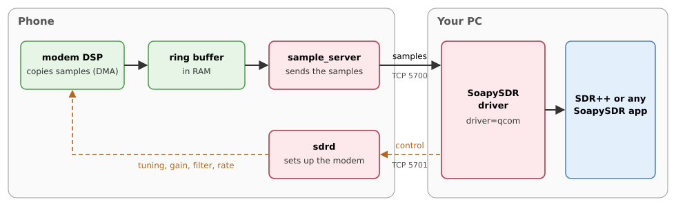

# Sample stream: modem receiver as a SoapySDR device

Phone: Wileyfox Swift (MSM8916, Longcheer L8150) with Nura; see the main README
for possible twins.

Plug the phone into your PC with a USB cable, open any SoapySDR program, choose
the device **Qualcomm MSM8916 modem**, and you see the radio spectrum the
phone's modem receives. Everything on the phone starts by itself when the
program starts the stream.

Abbreviations are explained in the [glossary](../README.md#glossary).

## How the stream works



`sdrd` on the phone sets up the modem (firmware, test mode, tuning, gain,
filter, sample rate) and starts a small program on the modem's DSP, which copies
the received samples into a ring buffer in RAM. `sample_server` sends them over
TCP to your PC, where the SoapySDR driver (`driver=qcom`) hands them to the
application. The driver controls `sdrd` over a second TCP connection.

- Receive only, one channel, **7.2 - 11.25 and 14.4 - 14.8 MS/s** (default
  7.68). Formats: `CF32` and `CS16`. The modem delivers 20 bits per complex
  sample (block floating point: 8-bit I and Q mantissas and a shared 4-bit
  exponent). The driver expands this to 16-bit integers with a fixed gain of 48
  dB, which keeps the whole mantissa (exact for exponents >= 8; stronger signals
  clip in `CS16`, not in `CF32`).
- The link carries 2.5 bytes per sample over the USB network: 19.7 MB/s at 7.68
  MS/s, 28 MB/s at 11.25 MS/s, 37 MB/s at 14.8 MS/s (the packed 20-bit samples).
  The USB network carries about 37.5 MB/s, so 14.8 MS/s is the highest rate
  offered; above it records would be lost after about two minutes.
- While streaming, the modem is in the LTE factory test mode: ModemManager is
  stopped and masked (otherwise NetworkManager starts it again and the modem
  crashes) and there is no mobile data or telephony. Stopping the stream does
  not bring them back; run
  `sudo systemctl unmask --runtime ModemManager && sudo systemctl start ModemManager`
  or reboot the phone.

## Controls

- **Frequency**
  - Values: 735 - 995 MHz, 1195 - 2700 MHz (`getFrequencyRange` lists them; the
    LTE bands 1, 2, 3, 4, 5, 7, 8, 17, 20, 26, 27, 28 are inside)
  - Notes: `sdrd` picks the tuning method for every frequency from a table
    measured with a test tone (see below). The receiver tunes in steps of 100
    kHz (LTE channel) or 1 MHz (tuning script); the driver shifts the remainder
    digitally, so any frequency can be set. A change to another hardware step
    takes 0.3 - 0.5 s with a short gap in the data; a smaller change is instant.
- **Gain**
  - Values: `LNA`, 0 .. 18.2 dB in six steps
  - Notes: The nearest step is used and applies immediately. Not available on
    band 2. The dB values were measured on band 3.
- **Bandwidth**
  - Values: analog filter 1.4, 3, 5, 10, 15, 20, 40 MHz (default 40)
  - Notes: The nearest value is used. From 5 MHz up, the digital channel filter
    (which cuts at about 1.75 MHz) is bypassed. Changing between the two groups
    restarts the stream (about 1.5 s). Not available on band 2.
- **Sample rate**
  - Values: 7.2 .. 11.25 and 14.4 .. 14.8 MS/s, any value (nothing between 11.25
    and 14.4 can be reached)
  - Notes: The hardware reaches the requested rate within a few ppm
    (`getSampleRate` returns the exact value; values outside the range are
    clamped). Changing it restarts the stream (about 1 s). Bandwidth, gain and
    the channel are kept.
- **Antenna**
  - Values: `PRX` (primary receive path)
  - Notes: the phone's second receive path has no antenna
- **Time**
  - Values: every `readStream` returns the time of its first sample (ns, on the
    receiver's own 19.2 MHz clock) with `SOAPY_SDR_HAS_TIME`
  - Notes: The timeline is continuous. If data is really missing, `readStream`
    returns `SOAPY_SDR_OVERFLOW` and the time steps forward.

Device argument `cfo_hz=<Hz>` removes a known frequency error of the receiver
oscillator digitally.

Bands other than 3, 7 and 20 are not enabled in the modem's configuration.
`sdrd` enables them on the first start after the modem boots by calling the
firmware's own table builder with a wider band mask (this clears the receiver
tables of the bands in the mask, which the sample stream does not use). Band 12
and the TDD bands are not offered as channels.

Two kinds of tuning exist. An **LTE channel** makes the modem's test mode tune
the receiver to a channel of one of the bands (it also starts a cell search
there). **Free tuning** sends the receiver chip the register writes that the
firmware itself sends when it tunes (`data/ccs_tune.bin`; the band 3 and band 20
variants) with the oscillator words of the wanted frequency; above 2230 MHz the
input-stage values of the band 1 table are patched into the script. Which one is
used at a given frequency is decided by a table in `sdrd.cpp` (`ROUTES`): for
every point of a 10 MHz grid all methods that can serve it were compared with a
test tone at the same level, and the best one wins (switching only when another
method is more than 4 dB better). In short: the LTE band where the band is
clearly more sensitive (for example bands 5, 20, 27, 28, 4, 1 and 7), the band
20 script at 735 - 925 and 960 - 995 MHz, the band 8 channel at 925 - 960 MHz,
the band 3 script at 1195 - 2105 MHz, the band 3 script with band 1 values at
2175 - 2615 MHz. Frequencies without a table entry use the LTE band that
contains them, else the script whose range contains them. Nothing is reachable
at 995 - 1195 MHz, and above 2700 MHz the signal is below the noise. The chosen
method does not change what you see, only the sensitivity: it differs by up to
20 dB between the methods at the same frequency.

## Requirements

- The phone runs Nura with a slightly patched kernel (`/dev/mem`, DIAG port) and
  the custom modem firmware, both installed as described in `../pmos` and
  `../firmware`, and is reachable over the USB network (default `172.16.42.1`).
- Build host: Docker, python3, cmake, a C++ compiler, the SoapySDR development
  files (Debian/Ubuntu: `libsoapysdr-dev`), and the firmware build directory
  from `../firmware/build.sh`.

## Build

```
./build.sh [WORKDIR]      # WORKDIR as given to ../firmware/build.sh
```

Output in `WORKDIR/sdr`: `dsp_blobs.bin` (the DSP programs, linked for exactly
your firmware build), `wtr_luts.bin` (receiver gain and filter tables read from
the firmware image), `ccs_tune.bin` (the tuning scripts, copied from `data/`),
`sdrd`, `sample_server` (static aarch64) and `libqcomSupport.so` (the host
driver). The DSP programs must come from the same build as the firmware that
runs on the phone.

## Install

```
./install.sh [WORKDIR] [user@HOST]
```

Copies the service to the phone (`/usr/lib/sdr`), enables `sdr-sdrd.service` and
installs the driver into the SoapySDR modules directory of this PC. SSH (with
the password of the phone user) is used only for this installation.

## Use

```
SoapySDRUtil --find="driver=qcom"       # should list "Qualcomm MSM8916 modem @172.16.42.1"
```

Select the device `driver=qcom` in your application. A different phone address:
device argument `host=ADDRESS`, or the environment variable `QCOM_PHONE_HOST`;
`port=` selects another control port. Opening the stream (the first time after
boot about 3 s, later about 1.5 s) starts the modem test mode. No SSH is needed
for streaming.

After a reboot of the phone, `./start.sh` waits for the service and checks that
the driver lists the device. The phone keeps the stock modem firmware after a
reboot unless `qcom-sdr-modem-fw.service` is enabled (see `../firmware`);
`./start.sh --switch` loads the custom firmware and starts `sdr-sdrd` over SSH
(the modem is restarted once).

Control protocol (TCP 5701, text lines): `HELLO`, `BANDS`, `TUNE <Hz>`,
`GAIN <0-5>`, `BW <MHz>`, `START`, `STOP`, `STATUS` (described at the top of
`sdrd.cpp`); samples: TCP 5700, raw records of 3232 bytes (32-byte header + 1280
packed samples). `journalctl -u sdr-sdrd` on the phone shows the service log.

## Run

Any SoapySDR application can use the device `driver=qcom`; it is listed as
"Qualcomm MSM8916 modem". If a computer has other SDR devices (for example a
USRP), pick that entry or give the arguments `driver=qcom`. The stream starts
when the application starts it. To check that the device is found:
`SoapySDRUtil --find="driver=qcom"`.

- A changed frequency or sample rate restarts the stream for 1 - 1.5 s.
- The bandwidth values are the analog filter widths. An application that picks
  the bandwidth "automatically" usually takes the smallest one that is not below
  the sample rate; choose 40 MHz by hand if you want the widest.

Redirect the output of graphical SDR programs to a file when you run them from a
terminal: on a stream error some of them print the same error line millions of
times per second.

## Service options

`sdrd` (unit `sdr-sdrd.service`): `--idle-stock SECONDS` returns the modem to
the stock firmware and starts ModemManager that many seconds after the last
stream stopped (default: never; experimental, every return to stock adds a modem
restart); `--queue-mb N` size of the sender queue (default 4 MB = 0.1 s at 14.8
MS/s; a client that falls behind loses records instead of getting everything
late). Put them in an `ExecStart=` override (`systemctl edit sdr-sdrd`).

## Notes

- Restart of the modem (for example after a crash):
  `sudo systemctl restart sdr-sdrd` on the phone; the service notices the
  restart itself the next time a stream is started.
- The modem heap is small and never freed. The service keeps its 3 MiB block
  across service restarts (`/run/sdr/block`); after a reboot of the phone it
  allocates a fresh block.
- The spectrum is shaped by the analog filter selected with the bandwidth
  control; with the 1.4 MHz filter the passband is about 3 MHz wide.

## Receive path switch (band 8)

On this board the low-band receive path used for 925 - 960 MHz (band 8) needs
three pins of the modem chip (GPIO 79, 84 and 85, RF path select lines) at a
high level. The manufacturer's firmware sets them when it enters band 8; the
firmware built here does not, and without them GSM carriers in that band are not
received (the 935.6 MHz carrier is invisible, the noise floor is 20 dB lower).
`sdrd` therefore drives the three pins high after tuning to band 8 and hands
them back to the firmware at every other tuning step; with them high in any
other band the sensitivity drops by 10 - 25 dB. This needs no action from you.
